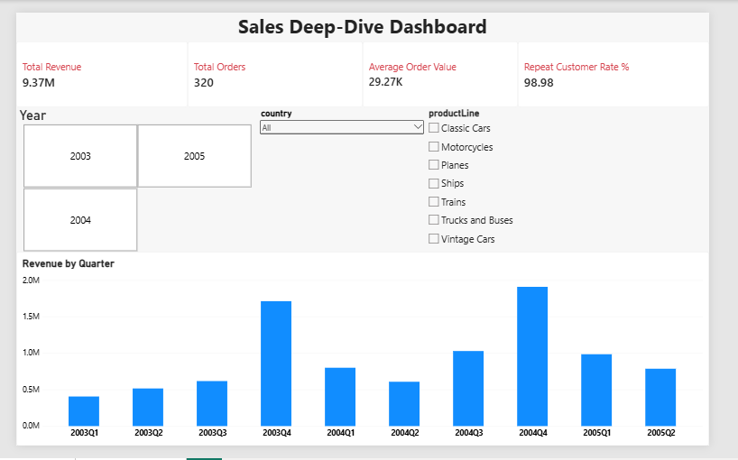
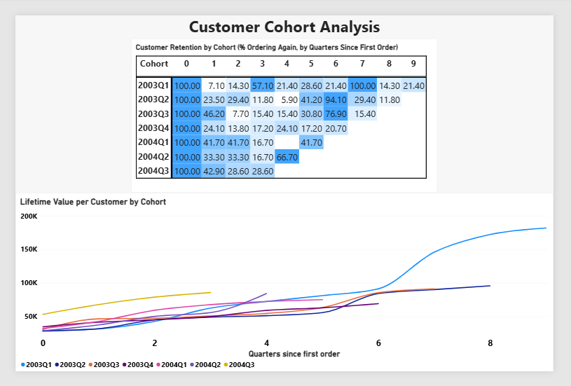

# Task 3: Deep-Dive Analysis and Interactive Dashboard

For this task I used the classicmodels sample database (a company that sells scale model cars). I picked a few KPIs, did a cohort analysis on the customers, and built a two-page interactive dashboard. I built it in Power BI first. Power BI Service does not accept personal email accounts, so I could not get a public link from it. I then rebuilt the same dashboard in Looker Studio (now called Data Studio) so that it has a live link.

**Live dashboard (Looker Studio):** https://datastudio.google.com/reporting/7617ca3c-ce60-4d58-b23d-912c20da15cb

## About the data

- Source: classicmodels database in MySQL
- I joined the orders, customers, order details and products tables into one table (one row per product in an order).
- Cancelled orders are left out, since they never turned into sales.
- Final data: 2,917 rows, 320 orders and 98 customers, from January 2003 to May 2005.

## 1. Core KPIs

| KPI | Formula | Why I chose it | Value |
|---|---|---|---|
| Total Revenue | Sum of (quantity ordered x price each) | Shows overall sales performance | 9,365,336 |
| Total Orders | Number of distinct orders | Shows how much business is coming in | 320 |
| Average Order Value | Total Revenue / Total Orders | Shows how much a customer spends per order | 29,267 |
| Repeat Customer Rate (%) | Customers with more than 1 order / Total customers x 100 | Shows customer loyalty | 98.98% |

## 2. Deep-dive: Cohort analysis

**What I did:** I grouped customers by the quarter of their first order. Each group is called a cohort (for example, the 2003Q1 cohort is everyone who first ordered between January and March 2003). Then I followed each cohort over the next quarters and measured two things:

- **Retention:** the percentage of the cohort that ordered again in each quarter.
- **Lifetime value (LTV):** the total revenue of the cohort so far, divided by the number of customers in it.

There are 7 cohorts, from 2003Q1 (14 customers) to 2004Q3 (7 customers). All 98 customers made their first order by 2004Q3.

### What I found

1. **Customers come back, but not every quarter.** 97 out of 98 customers placed more than one order, so loyalty is very high. But in any single quarter after the first, only about 8% to 47% of a cohort ordered again. These are business customers who order a few times a year, not every quarter.

2. **Sales are seasonal and Q4 is the busiest time.** Retention jumps in Q4. The 2003Q1 cohort was at 57.1% in 2003Q4 and 100% in 2004Q4. The 2003Q2 cohort was at 94.1% in 2004Q4.

3. **Lifetime value keeps growing.** For every cohort, the revenue per customer goes up each quarter. The oldest cohort (2003Q1) reached about 181,845 per customer after 9 quarters.

4. **Newer customers started spending more.** By the 4th quarter, the 2004Q3 cohort had reached about 85,623 per customer, compared to about 62,521 for the 2003Q1 cohort at the same point.

### Limitations

- The last three cohorts are small (6 to 12 customers), so their percentages move around a lot and should be read carefully.
- The data ends in May 2005, so the last quarter is incomplete.
- No new customers appear after 2004Q3, so there are no later cohorts.

## 3. Interactive dashboard

The dashboard has two pages. The Power BI file (`Task3.pbix`) and the live Looker Studio version have the same content.

**Overview**
- Four KPI cards: Total Revenue, Total Orders, Average Order Value, Repeat Customer Rate %
- Revenue by Quarter chart
- Three slicers: Year, country and product line. They filter the cards and the revenue chart.

**Cohort Analysis**
- Retention heatmap: cohorts as rows, quarters since the first order as columns. Darker blue means higher retention.
- Line chart of lifetime value per customer for each cohort

The cohort page has two drop-downs (one for the heatmap and one for the lifetime value chart) so you can pick a single cohort. The Year, country and product line slicers do not change this page, because it uses separate cohort tables that cover all customers.

Screenshots:

## 4. Files in this repo

| File | What it is |
|---|---|
| `1_export_query.sql` | SQL query that joins the tables and gives the data for the analysis |
| `2_cohort_analysis.py` | Python (Pandas) script that calculates the KPIs, retention and LTV |
| `sales_data.csv` | Data exported from MySQL |
| `kpi_summary.csv` | KPI results |
| `cohort_retention.csv` | Retention by cohort and quarter |
| `cohort_revenue.csv` | Revenue and LTV by cohort and quarter |
| `sales_data_for_powerbi.csv` | Clean data used in the Power BI dashboard |
| `4_prepare_looker_data.py` | Adds an order-count column per customer so the Repeat Customer Rate card works in Looker Studio |
| `sales_data_for_looker.csv` | Data used in the Looker Studio dashboard |
| `Task3.pbix` | Power BI dashboard file |
| `dashboard_overview.png`, `dashboard_cohort.png` | Dashboard screenshots |

## 5. How to run it

1. Run `1_export_query.sql` in MySQL Workbench (set the row limit to "Don't Limit") and export the result as `sales_data.csv`.
2. Put `sales_data.csv` and `2_cohort_analysis.py` in the same folder and run `python 2_cohort_analysis.py`.
3. Open `Task3.pbix` in Power BI Desktop. If it asks, point the data sources to the CSV files in your folder.

Tools used: MySQL, Python (Pandas), Power BI, Looker Studio
